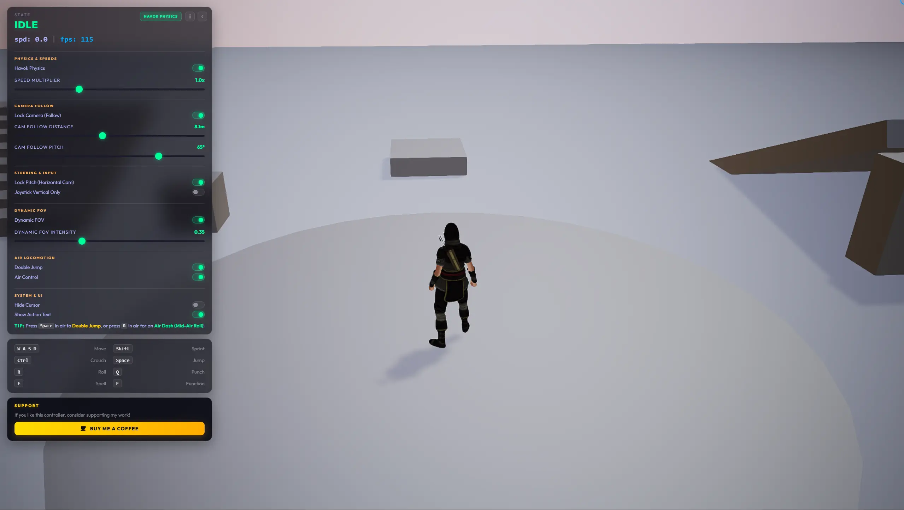
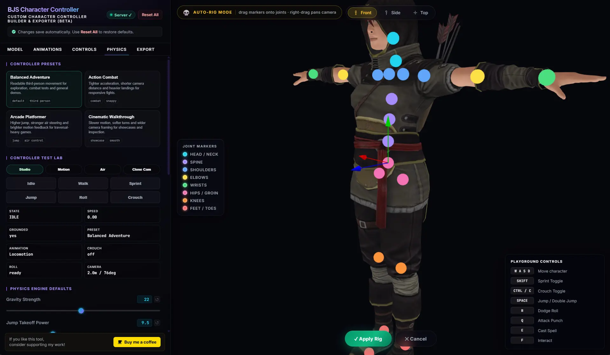

# 🎮 3D Character Animation Controller V2 for Babylon.js

An advanced third-person character locomotion and physics framework built with **Babylon.js**. This framework provides a fluid, powerful, and easy-to-use Character Controller with integrated physics, animations, and high-end visual features.

🎮 **Live Demo**: [https://viseni.com/_demos_/bjs_character_controller_v2/](https://viseni.com/_demos_/bjs_character_controller_v2/)



> ☕ If this controller saves you time, consider supporting its development!
>
> <a href="https://www.buymeacoffee.com/drlerian" target="_blank"></a>

---

## 🚀 Key Features

*   **Dual-Movement Modes (Physics vs Kinematic)**: Toggle dynamically between Havok Physics (dynamic simulation with body bodies) and standard Kinematic Collisions (ellipsoid-based movement) directly from the HUD.
*   **Locomotion Blend Tree**: Smoothly blends weight and speed between Idle, Walk, and Sprint.
*   **Dual-State Toggle Coexistence**: Crouch and Sprint operate as persistent toggles and can co-exist (allowing crouch-running).
*   **Dynamic Zoom & Camera Follow**: Smooth camera tracking with automated user-zoom sync (mouse wheel, trackpad, pinch) and double-tap recentering.
*   **Dynamic FOV & Camera Shake**: Camera Field of View expands with speed. Rotational camera shake is triggered on landing impacts relative to fall height.
*   **Camera Follow Lock (Direct Steering)**: Locks the camera directly behind the character for tank-style direct controls.
*   **Visual Enhancements**: Procedural dust/smoke trails at the feet, procedural leaning/banking on turns, slope-incline alignment, and squash & stretch scaling.
*   **Collision height adjustments & Ceiling protection**: Shrinks the capsule automatically when crouching/rolling, prevents standing up or rolling under low ceilings, and expands width when sprinting to prevent wall clipping.
*   **Ledge & Stairs Snapping**: Keeps the character grounded on sloped surfaces and stairs to prevent airborne jitter.
*   **Slope-Aligned Kinematic Traversal**: Kinematic collisions mode projects movement directly onto the ground normal to ensure butter-smooth ascent/descent on ramps and slopes.
*   **Smart Snap-Down Controls**: Dynamically disables downward snap forces when ascending stairs or steep slopes to eliminate physics/collision jitter.
*   **Implicit Self-Collision Prevention**: Prevents parent-capsule jitter by automatically disabling collision checks (`checkCollisions = false`) on imported character visual meshes.
*   **Mobile Touch Support**: Responsive virtual joystick and customizable glassmorphism action buttons.
*   **Gamepad Support**: Analog movement with configurable dead zone and edge-triggered jump, roll, sprint, crouch and action buttons.
*   **Production Rigging Pipeline**: Human and quadruped analysis, body-mesh selection, editable canonical bone assignment, topology-aware auto-rigging, quality diagnostics and deterministic animation retargeting.
*   **Air Dash (Mid-Air Roll)**: Perform a responsive dodge roll in mid-air with a horizontal speed boost and a 55% jump-power vertical hop (available if Double Jump is enabled, works even after double jumping).
*   **Action Interrupt Roll**: Pressing Roll immediately interrupts active attack combos or spell casts for instant responsiveness.
*   **Roll Cooldown & HUD Feedback**: A 1.1s cooldown prevents roll spamming, displaying a "DODGE COOLDOWN" HUD warning when pressed too early.
*   **Toggleable Action HUD Texts**: Toggle on-screen action text alerts (like "AIR DASH", "JAB", "CROSS!") directly from the System & UI settings drawer.

---

## ⚖️ Physics vs. Kinematic Modes

`character-controller.js` is a **unified single-file engine** that runs in two distinct physics regimes. Both modes live in the same class — a single `usePhysics` flag switches the internal code paths at initialization time.

*   **Havok Physics (Default)**: Leverages the WASM-powered **Havok Physics** engine. The character capsule is created as a dynamic `PhysicsBody` with defined mass and inertia properties, interacting naturally with other dynamic aggregates (like boxes, cylinders, and triggers).
*   **Kinematic Collisions**: Runs entirely within Babylon's native collision engine using kinematic ellipsoids (`moveWithCollisions`). Havok initialization is skipped entirely, providing maximum performance and deterministic locomotion.

### Explicit configuration (default behaviour)

Runtime options are authoritative. `initPhysics(scene)` tries Havok and falls back to kinematic collisions without reading or modifying browser storage. Pass `usePhysics: false` when kinematic mode is required.

### Overriding the mode

Preference persistence is deliberately opt-in. The bundled HUD examples use `persistPreferences: true`; embedded applications remain deterministic by default:

```javascript
const usePhysics = await initPhysics(scene, {
  usePhysics: true,
  persistPreferences: true
});
```

The same policy is available on the controller constructor:
```javascript
const charCtrl = new CharCtrl(playerCapsule, charRoot, camera, animCtrl, scene, {
  usePhysics: true,  // or false
  persistPreferences: false,
  config: {
    SPEED_MULTIPLIER: 1.5 // Multiplies walking, running and jogging speeds
  }
});
```

---

## ⚙️ Configuration Parameters

The `config` object in the constructor accepts a wide range of physics, camera, and gameplay properties to fine-tune character behavior:

| Parameter | Default | Type | Description |
|---|---|---|---|
| `GRAV` | `22` | *number* | Gravity force pulling the character down |
| `JUMP_PWR` | `9.5` | *number* | Vertical takeoff impulse force for jumping |
| `SPD_WALK` | `2.5` | *number* | Maximum physical walking speed |
| `SPD_JOG` | `3.0` | *number* | Maximum physical jogging speed (blend speed threshold) |
| `SPD_SPRINT` | `5.0` | *number* | Maximum physical sprinting speed |
| `SPD_CROUCH` | `2.0` | *number* | Maximum physical crouching walk speed |
| `SPD_CROUCH_RUN` | `3.2` | *number* | Maximum physical crouching run speed |
| `ACCEL` | `14` | *number* | Movement acceleration rate (speed-up responsiveness) |
| `DECEL` | `16` | *number* | Movement deceleration rate (braking/stopping responsiveness) |
| `ROT_SPD` | `40` | *number* | Character yaw rotation speed responsiveness |
| `AIR_CONTROL` | `false` | *boolean* | Steering control in mid-air (true = full control, false = no control) |
| `DYNAMIC_FOV` | `true` | *boolean* | Dynamically adjust camera Field of View based on speed |
| `DYNAMIC_FOV_MAX` | `0.10` | *number* | Maximum camera FOV expansion amount at full sprint speed |
| `CAM_FOLLOW_LOCK` | `true` | *boolean* | If true, the camera is locked behind the character's facing direction |
| `CAM_FOLLOW_PITCH` | `1.047` | *number* | Camera follow lock pitch (beta angle in radians, approx 60 degrees) |
| `CAM_FOLLOW_DIST` | `8.0` | *number* | Camera follow lock distance (radius in meters) |
| `CAM_LOCK_PITCH` | `false` | *boolean* | If true, drag input only rotates camera horizontally (locks pitch axis) |
| `JOYSTICK_LOCK_X` | `false` | *boolean* | If true, joystick input is locked to vertical axis only (no strafing) |
| `DOUBLE_JUMP_ENABLED` | `true` | *boolean* | If true, the character can perform a double jump in mid-air |
| `SPEED_MULTIPLIER` | `1.0` | *number* | Speed multiplier for walking, running, and jogging |
| `PLAY_PARTICLES` | `true` | *boolean* | Play procedural dust/smoke particles under the character's feet |
| `STRIDE_MATCHING` | `true` | *boolean \| 'full'* | `true`: Walk/Sprint playback rates scale with the character's leg length and the two loops stay phase-synced while blending. `'full'`: playback rate = ground speed ÷ measured clip speed (feet locked; pair with `SPD_*` from `charCtrl.measureLocomotion()`) |
| `UPPER_BODY_ACTIONS` | `false` | *boolean* | While walking/running, punches play on the upper body only and the legs keep moving |

The full list (35 keys, including `MOVING_PLATFORMS`, `HEAD_LOOK`, `FOOT_PLANTING`, `TWIST_DRIVER`, `MANTLE_ENABLED`, `COYOTE_TIME`, `JUMP_BUFFER`, `JUMP_CUT`, `JUMP_CUT_MULT` and `ACCEL_CURVE`) is `DEFAULT_CHAR_CONFIG.PHYSICS` in [js/character-controller.js](js/character-controller.js), also exposed as `window.DEFAULT_CHAR_CONFIG`.

### Changing config at runtime

```javascript
const applied = charCtrl.setConfig({ SPD_SPRINT: 7, DOUBLE_JUMP_ENABLED: false, TYPO_KEY: 1 });
// → { SPD_SPRINT: 7, DOUBLE_JUMP_ENABLED: false }   (console.warn once: unknown key "TYPO_KEY" ignored)
charCtrl.getConfig();                         // current value of every config key
charCtrl.onConfigChangedObservable.add(({ changes, source }) => save(changes)); // 'setConfig' | 'camera'
```

`setConfig` validates every key against the config table: unknown keys and wrong value types (e.g. a string for `GRAV`) warn once and are ignored. The constructor's `config` option uses the same validation. Writing instance fields directly (`charCtrl.SPD_WALK = 3`) keeps working. When the player zooms or drags the camera pitch, the controller updates `CAM_FOLLOW_DIST` / `CAM_FOLLOW_PITCH` and reports it through `onConfigChangedObservable` and the optional `onConfigChanged(changes, source)` option.

---

## 🔄 Dynamic Animation Remapping

### Automatic slot mapping

The controller plays clips by slot name (`Idle_Loop`, `Walk_Loop`, `Sprint_Loop`, `Crouch_Idle_Loop`, `Crouch_Fwd_Loop`, `Jump_Start`, `Jump_Loop`, `Jump_Land`, `Roll`, `Punch`, `Punch_Jab`, `Punch_Cross`, `Spell_Simple_Enter`, `Spell_Simple_Shoot`, `Spell_Simple_Exit`, `Interact`). `AnimCtrl` first matches clips by their clean name (`Armature|Walk_Loop` → `Walk_Loop`). A slot without an exact match falls back to the same keyword table as the Builder's auto-mapper (`window.STANDARD_ANIM_SLOTS`), so `Walking`, `Run` or `Idle_Breathing` are picked up automatically. A clip is only used by two locomotion slots when no other clip matches. The result is reported, and a missing `Idle_Loop` / `Walk_Loop` / `Sprint_Loop` produces one console warning:

```javascript
console.log(animCtrl.mappingReport);
// { exact: ['Idle_Loop', 'Jump_Start', ...], keyword: [{ slot: 'Walk_Loop', clip: 'Walking' }], missing: ['Punch'] }
```

Pass `autoMapAnimations: false` to `setupCharacter` (or `{ autoMap: false }` as the third `AnimCtrl` argument) to keep exact names only. Explicit mappings (a preset, `configure`, `setAnimation`) always override the automatic choice.

You can dynamically change any animation on the character controller or adjust keyframe ranges at runtime using the `AnimCtrl` instance (accessed via `charCtrl.anim`):

### 1. Reassigning Animations (Setters)
Pass a new Babylon `AnimationGroup` to dynamically swap any of the pre-mapped animations:

```javascript
// Remap basic locomotion
charCtrl.anim.setWalkAnim(newWalkAnimGroup);
charCtrl.anim.setRunAnim(newRunAnimGroup);
charCtrl.anim.setIdleAnim(newIdleAnimGroup);

// Remap crouch states
charCtrl.anim.setCrouchIdleAnim(newCrouchIdle);
charCtrl.anim.setCrouchFwdAnim(newCrouchWalk);

// Remap jumps and actions
charCtrl.anim.setJumpStartAnim(newJumpStart);
charCtrl.anim.setJumpLoopAnim(newJumpLoop);
charCtrl.anim.setJumpLandAnim(newJumpLand);
charCtrl.anim.setRollAnim(newRoll);
charCtrl.anim.setPunchJabAnim(newPunchJab);
charCtrl.anim.setPunchCrossAnim(newPunchCross);
charCtrl.anim.setSpellEnterAnim(newSpellEnter);
charCtrl.anim.setSpellShootAnim(newSpellShoot);
charCtrl.anim.setSpellExitAnim(newSpellExit);
charCtrl.anim.setInteractAnim(newInteract);

// Remap any custom animation key
charCtrl.anim.setAnimation('Custom_State_Name', myAnimGroup);

// Unmap a slot (the Builder's "None")
charCtrl.anim.clearAnimation('Roll');
```

### Runtime animation packs, layers and stride data

```js
// Load and retarget an animation pack at runtime (no server; Babylon.js 9 AnimatorAvatar)
const { added, report } = await charCtrl.loadAnimations('assets/emotes.glb'); // URL, ArrayBuffer, Blob or File
charCtrl.anim.play('Wave', false);

// Upper-body layer (AnimationGroupMask) over whatever plays underneath
charCtrl.anim.playUpperBody('Punch_Cross', { blend: 0.1, onEnd: () => {} });
charCtrl.anim.stopUpperBody(0.2);

// Additive layer (AnimationGroup.MakeAnimationAdditive), e.g. breathing or a flinch
charCtrl.anim.playAdditive('Hit_Chest', { weight: 0.6, loop: false });
charCtrl.anim.setAdditiveWeight('Hit_Chest', 0.3);

// Natural ground speed of the locomotion loops (world m/s at speedRatio 1)
console.log(charCtrl.measureLocomotion()); // { Walk_Loop: 1.02, Sprint_Loop: 8.79, ... }
```

`window.BJSRetarget` exposes the same client retargeter (`retargetAnimationGroups`, `loadRetargetSource`, `buildRetargetBoneMap`, `canonicalBoneRole`, `readGlbJson`). It maps bones with the same canonical roles as the server, restores the source clip's saved reference pose (`bjsRetargetPoses` of merged libraries, otherwise its T-pose clip), temporarily aligns the character's rest arms to that pose (T- vs A-pose), keeps only rotations plus root translation, and grounds hovering clips like the server.

### 2. Modifying Playback Keyframe Ranges
Change the start/end frames of an animation without replacing the group:
```javascript
// setAnimationRanges(animKey, startFrame, endFrame)
charCtrl.anim.setAnimationRanges('Walk_Loop', 10, 45);
```

---

## 🕹️ Controls Layout

### Keyboard (PC):
*   `W`, `A`, `S`, `D` / `Arrow Keys`: Movement.
*   `Shift`: Sprint (Toggle).
*   `Ctrl`: Crouch (Toggle).
*   `Space`: Jump / Double Jump.
*   `R`: Dodge roll / Air Dash:
    *   **Action Interrupt:** Instantly cancels active attack combos or spell casts.
    *   **Roll Cooldown:** 1.1s cooldown between rolls (triggers a "DODGE COOLDOWN" HUD alert).
    *   **Air Dash:** If Double Jump is enabled in settings, performs a mid-air roll with a horizontal boost and a 55% jump-power vertical hop (usable even after double jumping).
*   `Q`: Punch combo.
*   `E`: Spell casting.
*   `F`: Interaction.
*   `Mouse Drag`: Orbit camera / Double-click to recenter.

### Mobile Touch:
*   **Left Hand**: Floating Analog Joystick.
*   **Right Hand (Buttons)**: `SPELL`, `ACT`, `CROUCH`, `ROLL`, `SPRINT`, `JUMP`.
*   **Canvas Double-Tap**: Recenter camera.

---

## 🛠️ Implementation Quickstart

### ⚡ Quick start (one call)

Load Babylon.js 9, its glTF loader and (optionally) Havok, then the controller, and create the character with `createCharacter`:

```html
<script src="https://cdn.babylonjs.com/havok/HavokPhysics_umd.js"></script> <!-- optional -->
<script src="https://cdn.babylonjs.com/babylon.js"></script>
<script src="https://cdn.babylonjs.com/loaders/babylonjs.loaders.min.js"></script>
<script src="js/character-controller.js"></script>
<script>
  (async () => {
    const engine = new BABYLON.Engine(document.getElementById('c'), true);
    const scene = new BABYLON.Scene(engine);
    new BABYLON.HemisphericLight('light', new BABYLON.Vector3(0, 1, 0), scene);
    const ground = BABYLON.MeshBuilder.CreateGround('ground', { width: 60, height: 60 }, scene);
    ground.checkCollisions = true;

    const player = await createCharacter(scene, {
      model: 'assets/character_animated.glb', // URL, or a file name under assetsPath ('assets/')
      physics: false,                         // true | false | 'auto' (default, see below)
    });
    engine.runRenderLoop(() => scene.render());
  })();
</script>
```

`createCharacter(scene, options)` resolves to `{ playerCapsule, charRoot, animCtrl, charCtrl, scene, report, camera, usePhysics, dispose() }`:

| Option | Default | Description |
|---|---|---|
| `model` | `'character_animated.glb'` | Character GLB: URL (`'models/hero.glb'`) or a file name under `assetsPath`. Optional when the preset names the character. |
| `animations` | — | Separate animation GLB (server merge, else client retargeting). |
| `preset` | `BAKED_PRESET` | Preset object or URL of its JSON (see **Presets**); `false` ignores a baked preset. |
| `camera` | created | `ArcRotateCamera` to drive. When omitted, a follow camera is created, attached to the canvas and made active (none for `input: 'none'`). |
| `physics` | `'auto'` | `true`, `false` or `'auto'`: Havok when the scene already has physics, otherwise `initPhysics` is attempted (needs the HavokPhysics script or the `havok` option). With Havok, the level needs `PhysicsAggregate`s; use `physics: false` for `checkCollisions`-only levels. |
| `havok` | global `HavokPhysics` | HavokPhysics factory or instance (ESM). |
| `shadow` | — | ShadowGenerator for the character meshes. |
| `spawn` | `(0, 2, 0)` | `Vector3`, `[x, y, z]` or `{ x, y, z }`. |
| `config`, `keys` | — | Same as `setupCharacter` (merged over the preset). |
| `input` | `'player'` | `'player'` (keyboard, gamepad, touch) or `'none'` (AI / network, see **NPCs**). |
| `name` | `'player'` | Character name: meshes become `${name}_capsule` / `${name}_visual`; events carry it. |
| `onProgress` | — | `(percent, label) => {}` loading progress. |

Every other `setupCharacter` option (below) is accepted too. `dispose()` destroys the controller and disposes the capsule, meshes, skeletons, the character's animation groups and a camera it created.

### 📦 Presets

A preset is the whole character setup as data (schema `bjs-character-preset/v1`). The Builder exports it; you can also write it by hand:

```javascript
const preset = {
  schema: 'bjs-character-preset/v1',
  character: { filename: 'hero.glb', animationsFilename: 'animations.glb', assetsPath: 'assets/', capsuleScale: 1 },
  keys: { JUMP: ['Space', 'KeyK'], TAUNT: ['KeyT'] },
  config: { SPD_SPRINT: 6, DOUBLE_JUMP_ENABLED: false },
  animations: {
    Walk_Loop: { clip: 'Walk_Formal_Loop', from: 0, to: 32 }, // clip = clean name ("Armature|X" → "X")
    Roll: null,                                               // null = explicitly no clip
  },
  customActions: [{ name: 'TAUNT', clip: 'Dance_Loop', keys: ['KeyT'] }],
  animationEvents: { Walk_Loop: [{ type: 'footstep', frame: 5 }, { type: 'footstep', frame: 19 }] },
  mergeOptions: { boneMapOverrides: { pelvis: 'Hips' } },
};

await createCharacter(scene, { preset });                         // object
await createCharacter(scene, { preset: 'character.preset.json' }); // or a URL
```

* `character.*` fields are defaults: explicit `filename` / `model`, `animationsFilename`, `assetsPath` and `capsuleScale` options win.
* `keys` and `config` sit under the explicit `keys` / `config` options (explicit values win).
* Preset mappings are applied **before** `configure`, on every loading path (single GLB, server merge, client retargeting).
* Missing clips are listed once in the console and in `report.missing` (`[{ slot, clip }]`); `report.applied` lists what was set.
* A Builder `builder-config.json` is accepted as a preset as well.
* **Baked presets:** a controller downloaded from the Builder contains `const BAKED_PRESET = {...};`. It is used whenever no `preset` option is passed, so `createCharacter(scene)` or the stock `loadCharacter` reproduce the Builder setup without extra code.

`applyCharacterPreset(charCtrl, animCtrl, groups, preset)` applies a preset to an existing controller pair and returns `{ applied, missing }`.

### 🤖 NPCs / custom input

`input: 'none'` creates a character that reads no keyboard, gamepad or touch input and registers no window/DOM listeners. It also defaults to `hud: false`, so it cannot overwrite the player's HUD. Drive it from AI, network replication or your own UI:

```javascript
const npc = await createCharacter(scene, { model: 'assets/npc.glb', name: 'guard', input: 'none', spawn: [5, 2, 0] });
const ctrl = npc.charCtrl;

ctrl.setMoveInput(0, 1);      // x = right, z = forward, -1..1 (analog: 0.4 walks slower)
ctrl.pressAction('SPRINT');   // KEYS action names: JUMP, SPRINT, CROUCH, ROLL, PUNCH, SPELL, INTERACT, MOVE_*
ctrl.releaseAction('SPRINT');
ctrl.pressAction('TAUNT');    // custom actions registered on the AnimCtrl / preset
ctrl.setMoveInput(0, 0);      // stop
```

* Without a camera (`camera: null`, the default for `input: 'none'`), movement is world-relative (+Z forward, +X right) and camera logic is skipped. With a camera, movement is camera-relative. Pass `cameraControl: false` to read a shared camera without moving it.
* `setMoveInput` / `pressAction` also work on a `'player'` character (on-screen buttons, scripted sequences); analog input overrides keys while non-zero.
* `gamepadIndex: n` binds a player to `navigator.getGamepads()[n]` (local multiplayer); by default the first connected pad is used.
* Every controller flags its capsule and meshes with `metadata.bjsCharacter = true`, so the ground, wall and step rays of all characters ignore each other. Set `metadata.bjsCharacter = false` on a mesh to force it walkable; `CharCtrl.legacyCharacterNamePattern` (default `/playercapsule|autorig/i`) is the remaining name fallback.
* For network snapshots, write `charCtrl.root.position` and `charCtrl.rotY` directly.

### 📡 Events (Observables)

Babylon `Observable`s fire for every character, whatever the HUD mode:

```javascript
charCtrl.onStateChangedObservable.add(({ state, previous, character }) => {});
charCtrl.onSpeedChangedObservable.add(({ speed, previous }) => {});
charCtrl.onComboObservable.add(({ text, visible }) => {});            // "JAB", "DOUBLE JUMP", ...
charCtrl.onAnimationEventObservable.add(({ type, frame, label, animName, character }) => {});
charCtrl.onConfigChangedObservable.add(({ changes, source }) => {});
animCtrl.onAnimationChangedObservable.add(({ name, previous }) => {});
```

The `callbacks` option (`onStateChange`, `onSpeedChange`, `onCombo`), `charCtrl.onAnimationEvent` and the `charanimevent` window event keep working; `charanimevent` details now include `character`.

**HUD:** with the default `hud: 'auto'` the controller writes the demo HUD element ids when they exist (`hud-state`, `hud-speed`, `hud-fps`, `hud-anim`, `combo`, the touch joystick and buttons, `bar` / `bar-label`). With `hud: false` it never touches the DOM (no `getElementById`, no body classes, no touch joystick); build your own UI on the Observables.

### 📦 ESM / npm usage

`npm run build:lib` generates an npm-ready package in `dist/lib/` (`bjs-character-controller`): an ES module, the classic script (`bjs-character-controller/umd`), TypeScript declarations and a README.

```javascript
import * as BABYLON from '@babylonjs/core';
import '@babylonjs/loaders/glTF';
import HavokPhysics from '@babylonjs/havok';
import { useBabylon, createCharacter } from 'bjs-character-controller';

useBabylon(BABYLON, { havok: HavokPhysics });  // without it, the global BABYLON is used
const player = await createCharacter(scene, { model: '/assets/character_animated.glb' });
```

The module exports `CharCtrl`, `AnimCtrl`, `setupCharacter`, `createCharacter`, `initPhysics`, `applyCharacterPreset`, `normalizeCharacterPreset`, `DEFAULT_CHAR_CONFIG`, `STANDARD_ANIM_SLOTS`, `BJSRetarget` (and its functions), `S`, `normBone`, `cleanAnimName`, `lerp` and `lerpAngle`. The classic `<script>` keeps all `window.*` globals.

### Project layout

The `js/` directory is organized into subfolders by role:

- **`js/character-controller.js`** — Unified core engine. Handles Havok Physics and Kinematic modes, locomotion state machines, and animation blending. Exports `createCharacter`, `initPhysics` and `setupCharacter` helpers.
- **`js/ui/custom-hud.js`** — Tactile settings overlay (Camera Lock, Physics toggle, Dynamic FOV, Hide Cursor, Double Jump, Air Control, sliders). Optional.
- **`js/ui/custom-pointer.js`** — Spring-damper trailing cursor ring. Optional.
- **`js/examples/`** — Ready-to-run setup templates (`app.js`, `app-minimal.js`, `app-complex.js`).
- **`js/core/builder.js`** — Powers `builder.html`, the visual configuration tool (see below).

### ⚙️ `setupCharacter` (scene, camera and physics provided by your app)
`createCharacter` is a thin wrapper around `setupCharacter(scene, camera, usePhysics, options)`, which the app templates use through a `loadCharacter` helper together with `initPhysics`. It supports model paths, spawn locations, bounding ellipsoids, controls, presets and animations:

```javascript
// 1. Define character initialization helper
async function loadCharacter(scene, shadow, camera, usePhysics) {
  return setupCharacter(scene, camera, usePhysics, {
    shadow,                             // Optional: shadow generator to add character meshes to
    persistPreferences: true,           // Optional: allow HUD/browser preference persistence
    assetsPath: 'assets/',              // Optional: path to GLB assets folder (defaults to 'assets/')
    filename: 'character_animated.glb', // Optional: GLB file name (defaults to 'character_animated.glb')
    spawnPosition: new BABYLON.Vector3(0, 2, 0), // Optional: starting position override
    ellipsoid: new BABYLON.Vector3(0.35, 0.96, 0.35), // Optional: collision ellipsoid override
    keys: { JUMP: ['KeyK'] },           // Optional: remap keyboard controls directly
    config: { JUMP_PWR: 12 },           // Optional: override physical and camera parameters
    configure: ({ animCtrl, filteredGroups }) => {
      // Optional: callback to remap animations or customize keyframe ranges (runs after the preset)
      const formalWalk = filteredGroups.find(g => cleanAnimName(g.name) === 'Walk_Formal_Loop');
      if (formalWalk) animCtrl.setWalkAnim(formalWalk);
    }
  });
}

// 2. Initialize physics (Havok or Kinematic fallback)
const usePhysics = await initPhysics(scene, { persistPreferences: true });

// 3. Load the character using the helper
const { playerCapsule, charRoot, animCtrl, charCtrl, report } = await loadCharacter(scene, shadow, camera, usePhysics);

// 4. Hook up HUD setting toggles dynamically via custom-hud.js
if (typeof bindHUDControls === 'function') {
  bindHUDControls(charCtrl, camera, usePhysics);
}
```

Look clips up by name (`cleanAnimName(g.name)`), never by index: the order of `filteredGroups` depends on the exporter.

More `setupCharacter` options:

| Option | Default | Description |
|---|---|---|
| `animationsFilename` | — | Separate animation GLB: merged by the server (`/api/merge`), else retargeted in the browser. |
| `serverUrl` | `''` (same origin) | Base URL of the merge server (`/api/health`, `/api/merge`). |
| `serverMerge` | `true` | `false` skips the server and retargets client side. |
| `mergeOptions` | — | Server merge options, e.g. `{ boneMapOverrides }`. |
| `preset` | `BAKED_PRESET` | Preset object, JSON URL, or `false` (see **Presets**). |
| `capsuleScale` | `1` | Number or `{ x, y, z }` capsule scale. |
| `onProgress` | — | `(percent, label)`; without it `window.setLoad()` or `#bar` / `#bar-label` are updated (HUD mode only). |
| `name`, `input`, `hud`, `gamepadIndex`, `cameraControl`, `onConfigChanged` | — | Passed to `CharCtrl` (see **NPCs / custom input** and **Events**). |
| `autoMapAnimations` | `true` | Keyword fallback for unmatched standard slots. |
| `configure` | — | `({ animCtrl, charCtrl, filteredGroups, playerCapsule, charRoot, scene, preset, report }) => {}` |

Every loading path resolves to the same `{ playerCapsule, charRoot, animCtrl, charCtrl, scene, report }`; `report.mode` is `'server'`, `'client'` or `'single'`. Only the character's own animation groups are stopped: level and other characters' animations keep playing.

We have provided three setup examples to guide your implementation:
*   **[js/examples/app-minimal.js](js/examples/app-minimal.js)**: A bare-minimum integration template: engine, scene, lights, ground and one `createCharacter` call (camera, physics, capsule and controllers).
*   **[js/examples/app-complex.js](js/examples/app-complex.js)**: A full-featured setup designed to demonstrate how the character controller functions with a highly complex 3D scenery model ([assets/backyard_demo.glb](assets/backyard_demo.glb)) containing many intricate, complex collisions and polygon-heavy geometry.
*   **[js/examples/app.js](js/examples/app.js)**: A fully featured production loading example including advanced lighting, shadows, skyboxes, procedural environment shapes (boxes, ramp, stairs), post-processing, and HUD settings synchronization.

---

## 🔧 Visual Builder (`builder.html`)



`builder` is an interactive GUI tool for visually configuring and exporting a custom character controller — no code editing required. You can use it as a static page, or run it with the local NodeJS development server to enable full backend-powered retargeting and GLB merges.

### 🌐 Running with NodeJS / npm (Recommended)

To run the local server which powers advanced skeletal retargeting, GLB animation merges, and asset optimizations via the local backend API:

1. **Install dependencies:**
   ```bash
   npm install
   ```

2. **Start the local server:**
   ```bash
   npm start
   ```

3. **Open the builder:**
   Navigate to [http://localhost:3000/builder](http://localhost:3000/builder) in your browser.

4. **Run the complete verification suite before publishing changes:**
   ```bash
   npm run check
   npm audit
   ```


### Tabs

| Tab | What it does |
|---|---|
| **Import & Rig** | Import GLB/FBX, choose the deforming body meshes, adjust transforms and bind pose, inspect skeleton health, edit canonical bone assignments and generate or rebuild rigs |
| **Animate** | Auto-match animation names, preview clips, define gameplay frame markers and add custom triggered actions |
| **Input Mapping** | Remap keyboard/gameplay actions and restore individual defaults |
| **Controller** | Apply presets, use the live test lab, and tune movement, camera and feel |
| **Physics** | Configure collision, gravity, jumping, grounding, slopes and Havok/kinematic behaviour |
| **Validate & Export** | Readiness checklist (character, skeleton, core animations, offline limits) with one-click fixes, then **Download everything (.zip)** or the individual files |

Builder preferences auto-save locally for editing convenience. Exported runtime controllers do not inherit that storage unless the application explicitly enables `persistPreferences`.

**Basic / Advanced:** the sidebar starts in Basic mode, which hides expert controls (posture sliders, pivot axes, the bone tree, batch rigging and config files). Tick **Advanced** in the header to show everything; the choice is remembered.

**Drop anywhere:** drop one or more `.glb`/`.fbx` files on the 3D view. With no character loaded the first file becomes the character and the rest its animations; otherwise the Builder asks whether the files are a new character or animations. A dropped `builder-config.json` is imported. The animation dropzone accepts several files at once (Replace/Merge is asked once).

**Long jobs:** server work (FBX conversion, auto-rig, retargeting, export) shows the worker's real stage and the elapsed time, and has a **Cancel** button that stops the server worker. A busy server queue (HTTP 429) is retried automatically. Heavy jobs time out after `BCC_JOB_TIMEOUT_S` seconds (default 300). Notifications stack; errors stay longer and can be dismissed.

### 💀 FBX Direct Import & Bind-Pose Posture Tuning

When running the NodeJS backend, the **Import & Rig** tab offers advanced rigging, conversion, and alignment utilities:

*   **Direct FBX Support**: Drag-and-drop `.fbx` character models and animation files. The server auto-converts them to `.glb` under-the-hood (using `fbx_api.mjs`), fixing materials and flattening the `RootNode` transformation to avoid rotation/scale offset issues.
*   **Scale & Pivot Offsets**: Fine-tune character sizing using uniform scaling or independent X, Y, and Z scaling. Adjust the pivot offset (X, Y, Z) and use the **Pivot to Ground** helper to easily snap a character's feet to the ground level.
*   **Skeletal Posture Adjustments**: Straighten or adjust character postures (e.g., matching A-poses to T-poses) using bind-pose angle sliders for **Arm Spread**, **Arm Splay**, **Shoulder Raise**, **Leg Spread**, **Hips Tilt**, and **Spine Straightening**.
*   **Skeleton Tree & Health Report**: View the hierarchy, humanoid/quadruped body plan, coverage, duplicate and unresolved roles, and confidence/reason for every canonical mapping. Every role can be reassigned to an exact node without renaming the source asset.

### 💀 Auto-Rig (skeleton generation for skinless meshes)

**Zero-click by default.** Dropping a mesh without a skeleton stands it up facing +Z, puts its feet on the ground, analyses it, rigs it and retargets the animation library — no options to choose:

| Decision | How it is made |
|---|---|
| Humanoid or animal | **Body plan: Automatic** uses the analysis' detected body plan (the joints are re-analysed once for that layout) |
| Number of fingers | **Hand fingers: Automatic** adopts the digit count detected on both hands; unresolved hands keep solid weights |
| Rig or ask | When the analysis is unsure (`verdict: 'review'`), nothing is rigged blindly: the joint editor opens with only the doubtful joints shown as **red** markers and listed as chips that frame the camera on them. Confident results are applied directly |
| After the rig | The server's skin report (confidence, review joints, reasons) is shown as a notification; a rig the server flags offers **Review joints**, every rig offers **Undo** |

Explicit choices (Humanoid/Animal, 0–5 fingers) still override the detection. Expert settings (skeleton naming, symmetric editing, auto-depth, snap/swap, finger skinning mode, pose profiling, twist bones — on by default — bone-aligned orientation, layout presets) live under **More rig options**. **↶ Undo last rig** restores the static mesh or the previous skeleton. **Batch auto-rig** runs the same pipeline per file (layout detected per file) and downloads one `.zip` with a `batch-report.json`.

Manual flow — **Import & Rig → Skeleton → Generate Skeleton (Auto-Rig)**:

1. Choose exactly which meshes form the deforming body. Automatic selection excludes likely floors, props and accessories; manual selection is available for ambiguous assets. The server then analyzes the selected vertex cloud — not just the bounding box — and selects a humanoid or quadruped body plan.
2. For humanoids it proposes Mixamo-named joint positions: it detects the crotch (where the body splits into legs), shoulder height, hand positions (works for both **T-pose and A-pose** meshes), per-leg offsets, and follows hunched spines.
   For meshes in **non-standard poses** (crouching, sitting, action poses) a pose-independent topology pass kicks in automatically: the mesh is voxelized, the interior is filled (works on non-watertight meshes), and the five extremities (head, hands, feet) are found on the geodesic graph and classified by body topology — legs merge far from the head, arms merge near it. Joints are placed along the detected limb centerlines.
3. The builder enters a dedicated **rig viewport mode**: the character is isolated, draggable yellow joint markers appear, with Front/Side/Top camera presets (keys `1`/`2`/`3`) and optional **symmetric editing** (left ↔ right mirroring).
4. **Apply Rig** builds the skeleton, computes bounded topology-aware skin weights server-side, preserves unselected rigid meshes and morph deltas, and re-merges the animation set automatically. The final quality report records selection, coverage, warnings and compatibility.

Already-rigged characters get **Adjust Skeleton** instead: markers seed from the current bind pose, and applying moves the existing joints while preserving the hierarchy, extra bones (fingers/twist) and the original artist skin weights.

FBX/Sketchfab rigs with `spine1 → spine2 → spine3` and `l/r leg → knee → foot → toes` are mapped by their anatomical roles. Marker display follows the exact imported bones across coordinate conversions and reopening. Animation retargeting aligns reversed scene axes before pose adaptation, and rebuilding retains valid coincident joint origins from the source rig.

Numbered humanoid rigs can also be recognized from their hierarchy and joint positions: the fallback requires an upright, outstretched pose, two complete five-finger hands and matching arm/leg chains. It preserves imported joints and weights, including shared palm helpers; ambiguous layouts remain unresolved. Retargeting adds an unweighted compatibility joint for a missing middle-spine segment. Geometry diagnostics measure the weighted skin pose, including exports with unused synthetic root joints.

**Hands and placement review:** the analysis panel reports each hand separately and provides **Inspect** buttons for close-up placement. Finger detection follows connected triangle branches through successive hand sections and estimates the three joint centers on each branch. It supports the selected 2–5 finger layout and hand rotation. Fused fingers, closed fists, ambiguous thumbs and insufficient geometry remain marked for review instead of being classified as a complete hand.

**Finger skinning** defaults to **Automatic · detected hands only** in the editor. Unresolved hands keep solid hand weights; use **Use my reviewed finger markers** after placing all finger joints, or choose **Solid hands**. Finger influences are restricted across neighboring digits so bending one finger does not pull adjacent fingertips. The API accepts `skinFingers: 'auto'`, `true` (reviewed markers), or `false` (the API's backward-compatible default).

**Skin weights** combine a sharp inverse-distance falloff (d⁻⁶, max of straight-line and voxel-geodesic distance) with joint-centred blends, a rigid skull, a pelvis spanning both hips and an upper chest spanning the collarbones. Smoothing runs across **all** weighted meshes and primitives at once, so coincident vertices of split bodies (body / tops / shoes, UV seams) always get identical weights and seams cannot open. Measured against the artist weights of the 9 reference rigs (`test/autorig-weights.test.mjs`) the mean weight error is **11.7%** (was 23.1%) and the dominant bone differs on 10.4% of vertices (was 15.2%).

**Deformation stress test:** after weighting, the rig is posed in 8 poses — squat, arms up, arms down, 130° elbows, 45° torso twist, 60° head turn, 90° wrist twist and finger curl — and every region is scored for triangle distortion, inverted/collapsed triangles and candy-wrapper volume loss (pass limits calibrated on what the artist rigs themselves reach). It costs ~3% of the rig time on a 1M-vertex mesh and can be disabled with `deformationTest: false`.

**Confidence & verdict:** `guessJoints` and the rig report expose `jointConfidence`, `confidence` (0–1), `reviewJoints`, `reviewReasons` and `verdict: 'ok' | 'review'`, built from detector agreement, fallbacks, markers outside the mesh, finger detection and the stress-test regions. Only deforming joints can force a review (fingers of unresolved hands stay rigid and are merely listed). All reference rigs pass as `ok` both from their own joints and blind. A truncated voxel budget or disabled geodesic weighting now adds a note and lowers confidence instead of failing silently. `onProgress(stage, fraction)` reports `select, orient, analyze, fingers, bind, weights, smooth, validate, deform-test, write`; the Builder shows it live.

Weights are normalized before surface smoothing, and twist bones use their actual skin indices even when finger bones are unweighted. Generation checks every vertex against the exported bind matrices and aborts if the rest-position error exceeds `height × 0.00002` or the weights are invalid. Rebuild also accounts for individual vertex influences when an imported skeleton was saved away from its bind pose. The report exposes `restValidation`, placement `diagnostics` and active finger skinning; its influence score is a heuristic, **not an anatomical accuracy percentage**. The stress poses catch the common failures (collapsing elbows, folding hips, candy-wrapper wrists) but cannot guarantee every animation or detect cloth/body collisions.

Applying an existing rig without moving its joints preserves the current scene, animation library and posture. Retargeted GLBs retain their animation reference poses in extras, so later rig reloads and exports do not accumulate orientation, posture or root-motion corrections when the source has no T-pose clip. Repeated merges also retain the original unit scale and pivot reference. Keep the original model and animation files: these references cannot recover a deformation already baked into an older export.

**Joint orientation:** `boneOrientation: 'world'` (default) binds every joint with the world axes; `'aligned'` (builder checkbox *Bone-aligned joint orientation*) binds DCC/engine-style frames with +Y along the bone and +Z towards the front, which makes local roll meaningful for IK, twist drivers and external tools. Retargeted motion is identical for both. Every generated joint records its anatomical role in `extras.bjsCanonical`, so merges map naming presets such as Blender's `spine.001` or `f_index.01.L` exactly.

Generate the skeleton in the mesh's actual pose. T/A-pose previews require an existing skin; they cannot reposition markers independently of an unskinned mesh. Asymmetric hand placement is preserved, and API symmetrization is explicitly enabled with `symmetrize: true`. Humanoid and quadruped templates still require inspection for unusual proportions, hidden anatomy or unsupported body plans.

### 🎭 Custom Actions & Animations

In **Animate → Custom Animations**, you can extend the controller by registering completely new character actions (e.g., `TAUNT`, `DANCE`, `WAVE`):
*   Map a custom action name to any animation group in the library.
*   Assign key triggers directly to the custom action.
*   In the exported snippet, these actions are configured and bound automatically.
*   You can trigger custom actions through the complete controller state machine using `charCtrl.triggerAction('CUSTOM_ACTION_NAME')`.

### 🎯 Animation Events (gameplay frame markers)

In **Animate → Animation Events** you can attach typed markers (`footstep`, `hit`, `cast`, `sound`, `particle`, `camera`, `custom`) to any mapped animation at a specific frame:

- Markers fire **live in the builder viewport** (toast + console) while previewing or playing animations — including during crossfades and inside the Locomotion blend tree (footsteps fire on Walk/Sprint loops).
- Markers survive character swaps: they are kept as long as the slot maps to the **same clip**, and a **Clear All** button removes every marker at once.
- The Export tab emits them as `charCtrl.animationEvents`. Consume them in your game:

```javascript
charCtrl.animationEvents = {
  Punch: [{ type: 'hit', frame: 12, label: 'impact' }],
  Walk_Loop: [{ type: 'footstep', frame: 5 }, { type: 'footstep', frame: 19 }],
};
charCtrl.onAnimationEvent = (evt, animName) => {
  if (evt.type === 'hit') applyDamage();
  if (evt.type === 'footstep') playFootstepSound();
};
// or listen globally:
window.addEventListener('charanimevent', (e) => console.log(e.detail));
```

### 🧪 Controller Presets & Test Lab

The **Controller** tab includes four one-click controller presets (**Balanced Adventure**, **Action Combat**, **Arcade Platformer**, **Cinematic Walkthrough**) and a **Controller Test Lab**: scenario camera chips (Studio / Motion / Air / Close Cam), action buttons (Idle, Walk, Sprint, Jump, Roll, Crouch — locomotion buttons drive the real blend tree, exactly like in-game), and a live metrics panel (state, speed, grounded, active animation, camera framing).

#### ↺ Parameter Reset Buttons
Beside every slider, toggle, or control mapping under **Controller**, **Physics** and **Input Mapping**, there is an `↺` reset button. Clicking it restores that single parameter without clearing the rest of the setup.

### 🔄 Retargeting & Animation Merging (`merge_api.mjs`)

The Visual Builder uses the canonical server-side module [merge_api.mjs](js/core/merge_api.mjs) (via `server.mjs`) to analyze, retarget and combine characters and animations deterministically.

When using the builder, you can import assets in different ways:
- **Separate Import:** Load a character in **Import & Rig**, then one or more external animation GLBs/FBXs in **Animate**.
- **Embedded Animations:** A character's own animation groups are available immediately after import; no duplicate upload is required.

After the per-bone change of basis, the merge applies the Babylon.js 9 `AnimatorAvatar` corrections server-side (all on by default, switchable per request):

| Option | Default | Effect |
|---|---|---|
| `FIX_ROOT_POSITION` | `true` | Root translation is scaled by the hips-to-feet ratio of the two rigs (includes the source armature's unit scale, e.g. ×0.01 exports). |
| `FIX_GROUND_REFERENCE` | `true` | `true`/`'clip'`: one hips offset per clip from the lowest foot/toe joint — clips whose source hovers slightly above the floor are grounded, in-place jump/airborne clips keep their clearance scaled by leg length. `'frame'`: per-frame proportional match (Babylon behaviour). |
| `GROUND_CONTACT_TOLERANCE` | `0.12` | Source hover (in leg lengths) still treated as ground contact. |
| `FIX_ANIMATIONS` | `true` | Hemisphere-continuous quaternion tracks and repair of orthogonal (180° flip) keys. |

The merge also drops duplicate source joints that alias one character bone (UE5 `root` + `pelvis`, CC `Hip` + `Pelvis`), keeps finger chains on the hand's basis only when both rigs orient fingers alike (≤ 12°, otherwise per-bone), and retargets morph-target weight tracks by mesh and morph-target name. `/api/merge` returns the diagnostics in the `X-Merge-Report` header (root-motion scale, grounded clips, repaired keys, dropped tracks, hierarchy differences, morph tracks), shown in the builder's **Rig Health** panel.

Edits in **Animate → Standard Animations** are saved automatically, including the selected clip, From/To frames, and explicit **None** selections. Applying a rig or reloading animations preserves these edits. If a selected clip is temporarily unavailable, it appears as **(not loaded)** with its saved range until the clip is loaded again. Use an action's `↺` button to return it to automatic mapping. These settings also travel with `builder-config.json`.

---

## 📥 Exporting & Downloading Options

**Validate & Export** opens with a readiness checklist: character loaded, skeleton present and reviewed, Idle/Walk/Sprint mapped, how many action clips are mapped, and what offline mode cannot export. Each problem has a button that takes you to the fix.

### 🎁 Download everything (.zip) — recommended
One file with everything a project needs:

| File | Content |
|---|---|
| `assets/character_animated.glb` (Pre-merged) or `assets/<character>.glb` + `assets/animations.glb` (Runtime) | The model(s) |
| `js/custom-character-controller.js` | The controller with this setup baked in (`BAKED_PRESET`) |
| `character.preset.json` | The same setup as data, for the stock controller: `createCharacter(scene, { camera, preset })` |
| `index.html` | A runnable example scene (Babylon.js from the official CDN) |
| `README.txt` | Integration steps |

Unzip, serve the folder with any static server (`npx serve .`) and open `index.html`.

Deleted library clips stay deleted in every export. Offline, animations retargeted in the browser cannot be written into a GLB (there is no glTF serializer in the page); the Builder says so and offers **Runtime Retargeting** mode, which exports the character and animation files separately and retargets them when the game loads.

The individual downloads below remain available:

### 🔀 Integration Modes (Pre-merged GLB vs. Runtime Retargeting)
When exporting your setup, you can choose between two integration architectures depending on your project needs:

*   **Pre-merged GLB (Baked Merge)**:
    *   **How it works**: Merges character meshes and animation channels into a single `character_animated.glb` file.
    *   **Best for**: Single character games, simple setups, or engines where loading multiple separate files is not desired.
    *   **Drawback**: Duplicate data. If you have 10 characters sharing the same locomotion set, you will be downloading those animation frames 10 times.
*   **Runtime Retargeting (Client-Side Dynamic Retargeting)**:
    *   **How it works**: Keeps character meshes (`character.glb`) and animation libraries (`animations.glb`) separate. [setupCharacter](js/character-controller.js) requests the same canonical server merge used by the builder and falls back to client retargeting when the service is unavailable. Manual `boneMapOverrides` travel with the exported setup.
    *   **Best for**: Multi-character games, RPGs, or modular projects. Reuses one shared animation file across dozens of characters, drastically reducing download size and memory footprint.
    *   **Note**: Requires Babylon.js 9+. The client fallback uses the server's bone roles and reference poses; the server merge additionally straightens A-pose legs and is the reference result.

### 1. 📋 Export Code Snippet (Preview & Copy)
The snippet is a `CHARACTER_PRESET` object (schema `bjs-character-preset/v1`) plus a `loadCharacter` replacement for `js/examples/app.js` that passes it as `preset`, and the equivalent one-call `createCharacter(scene, { camera, preset })`. The preset carries:
*   **Model files and transform scaling** (`character.filename`, `animationsFilename`, `capsuleScale`).
*   **Custom Key Bindings** (`keys`).
*   **Every physics/camera parameter** (`config` — the full controller set, not only the ones tuned in the Builder).
*   **Mapped Animations, frame ranges and explicit "None" slots** (`animations`), **Custom Actions** (`customActions`).
*   **Animation Events** (`animationEvents`) and manual **bone overrides** (`mergeOptions`).

**Download character.preset.json** saves the same object as a file.

### 2. 💾 Saving & Restoring Builder Config (`builder-config.json`)
Allows you to save/load your visual builder configuration presets:
*   **Download builder-config.json**: Saves schema-versioned transforms, exact bone assignments, key bindings, physics settings, animation mappings, custom actions and events. It intentionally does **not** embed model or animation binaries (`includesAssets: false`).
*   **Import builder-config.json**: Restore your saved configuration at any time to resume working in the builder without losing your adjustments.

### 3. 📦 Exporting the Character as GLB (with animations)
Click **Download character_animated.glb** to download a single, self-contained GLB file that merges your character mesh with the active animations retargeted and merged directly into the skeletal structures on the server. Ready for drag-and-drop into your assets folder.

### ⚡ 4. Downloading Baked Controller (`custom-character-controller.js`)
Generates a tailored standalone `character-controller.js` file with your settings pre-baked:
*   Replaces the default configurations (`DEFAULT_CHAR_CONFIG`) inside the script with your custom physics (merged over the controller's full defaults), keys, and touch layouts.
*   Keeps baked defaults authoritative and does not inject or mutate `localStorage`; persistence remains an explicit application choice.
*   Fills `BAKED_PRESET` with the preset above. `setupCharacter`/`createCharacter` apply it on **every** load path (single GLB, server merge and client retargeting), so mappings, frame ranges, custom actions and events work with zero extra code. Older controller files without `BAKED_PRESET` still get the previous code injection.

```html
<!-- Use the downloaded file in place of the original: -->
<script src="js/character-controller.js"></script>
<!-- or, if using the builder export: -->
<script src="js/custom-character-controller.js"></script>
```
---

## 📚 Credits & License

*   **Rig**: Customized Mixamo skeletal rig.
*   **Animations**: [Universal Animation Library by Quaternius](https://quaternius.com/packs/universalanimationlibrary.html).
*   **License**: Licensed under the **MIT License** - see [LICENSE](LICENSE) for details. Keep the copyright notice and attribute the authorship of the Character Controller to **Diego Ramirez** in all copies.
